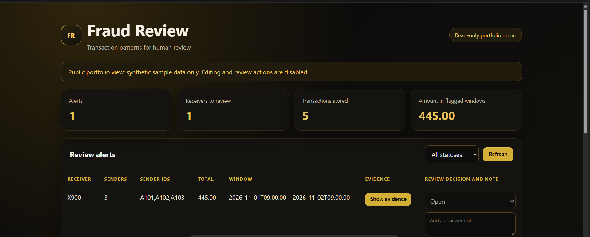

# Fraud Review Demo

A small Python prototype that analyzes transaction records and presents possible patterns for human review. It includes a FastAPI API, a SQLite database, a black-and-gold web dashboard, and CSV exports.
**Live demo:** https://fraud-review-demo.onrender.com/

This is a learning and portfolio project. It uses synthetic sample data and is not a production fraud detection system. An alert is only a pattern that a person may review; it does not prove fraud.

## Features
- Shows the matching transactions behind each alert, including sender, amount, and timestamp.
- Reads transactions from the file transactions.csv.
- Checks whether a receiver gets transactions from at least three distinct senders within a 24-hour window.
- Writes alert results to alerts.csv and stores transactions and alerts in fraud_demo.db.
- Provides an API for listing transactions and alerts, and submitting transactions.
- Lets a reviewer mark an alert open, escalated, or cleared and record a note.
- Keeps review history and lets the reviewer download it as a CSV file.

## Requirements

- Windows with PowerShell
- Python 3.15
- The packages fastapi and uvicorn

## Setup

Open PowerShell in the project folder:

    cd C:\Users\User\OneDrive\Documents\fraud-network-demo

If the virtual environment has not been created, run:

    py -3.15 -m venv .venv

Install the web dependencies:

    .\.venv\Scripts\python.exe -m pip install fastapi uvicorn

## Run the transaction analysis

From the project folder, run:

    .\.venv\Scripts\python.exe .\src\main.py

The program reads transactions.csv, updates the SQLite database, and writes alerts.csv.

The input CSV must have these column names:

    sender,receiver,amount,timestamp

Use ISO-style timestamps such as 2026-11-01T09:00:00. The sample rows in the project are synthetic.

## Run the web dashboard

Start the API from the project folder:

    .\.venv\Scripts\python.exe -m uvicorn api:app --app-dir .\src --reload

Keep that PowerShell window open while using the app. Open the dashboard on the same computer at:

<http://127.0.0.1:8000/>

Interactive API documentation is available at:

<http://127.0.0.1:8000/docs>

## API routes

| Method | Route | Purpose |
| --- | --- | --- |
| GET | /health | Check that the API is running |
| GET | /alerts | List current review alerts |
| GET | /transactions | List recent transactions |
| POST | /transactions | Add a transaction |
| POST | /alerts/review | Save a review decision and note |
| GET | /alerts/review-history | View review history |
| GET | /alerts/review-history.csv | Download review history as CSV |

## Project files

    fraud-network-demo/
    ├── src/
    │   ├── api.py
    │   ├── dashboard.html
    │   └── main.py
    ├── transactions.csv
    ├── alerts.csv
    └── fraud_demo.db

transactions.csv is input data. alerts.csv and fraud_demo.db are generated or updated by the program.

## Deploy a read-only portfolio demo

The public demo supports viewing synthetic alerts and transactions. Transaction submission and review decisions are disabled when the DEMO_READ_ONLY environment variable is set to true.

For a Render Web Service, use these settings:

- Runtime: Python 3
- Build command: pip install -r requirements.txt
- Start command: python src/main.py && uvicorn api:app --app-dir src --host 0.0.0.0 --port $PORT
- Environment variable: DEMO_READ_ONLY=true

Leave the Root Directory blank so these commands run from the project root. Render currently provides Python 3.14 for its native Python runtime; this project’s code is also developed locally with Python 3.15. The start command runs main.py to seed the SQLite database from the synthetic transactions.csv file whenever the service starts. The hosted demo is read-only because free Render services use an ephemeral filesystem and local database changes can disappear after a restart.

Render creates the public onrender.com URL after deployment finishes. Free services may sleep when idle and take time to wake up.

## Data and security

Use synthetic data only. Do not put real customer, bank, or payment information into this demo. The public portfolio mode is read-only, but this is still a prototype and is not designed for production use.

